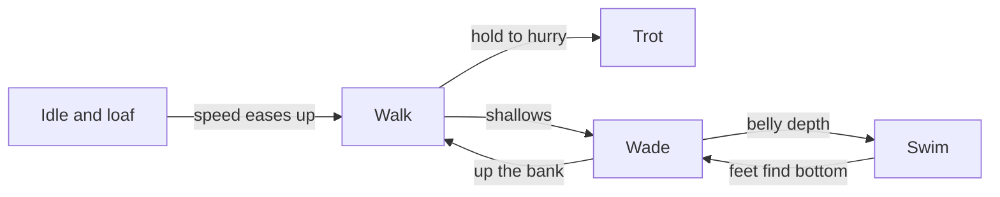
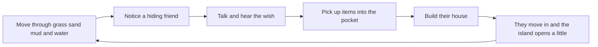

# Capybara Island — design

**By Meryl Meston.** Names below are stand-ins until she renames them. She owns the dialogue.

## Pitch

A lonely capybara lives on a quiet island. Sand, mud, reeds, and a swimmable pond are the first pleasure. Friends hide in that landscape. Each one tells you the house they want. You pick up what the house needs, see every item in a pocket, build the house, and they move in.

## Pillars

In order:

1. **A body in a habitat.** Surfaces, slopes, and water depth change the gait, the sound, and the waterline on the body.
2. **A real capybara, moving fluidly.** Low-poly and toy-like to look at. Heavy, short-legged, and smooth to control. The head leads, the barrel body follows, speed eases in and out, and land becomes wade becomes swim in one motion. Space adds a low cute hop: a squash, a round little arc, and a soft plop.
3. **Readable toys.** *Untitled Goose Game* clarity and *Donut County* chunky forms. Flat color, big silhouettes, soft shadow.
4. **One job at a time.** Once movement feels right: notice, talk, pick up, build. Everything you pick up stays visible in the pocket.
5. **The house is a gift.** Each friend asks for a specific home. You do not design a floor plan.
6. **Less lonely on screen.** Progress is houses, laundry, paths, and someone sitting outside.

*Animal Crossing* contributes only the neighbor, the wish, and building their home. Out of the first playable: bells, tools that break, a museum, fishing minigames, terraforming, seasons, multiplayer, and voice acting. Swimming stays. A capybara walks into the water as if it were more ground.

## The island

One continuous ground, larger than the first bowl. The pond stays at the origin and the grass shelf stays toward the south. Around them: a west meadow, an east wading channel, a north cove, and sandy spits. Gentle slopes only. A capybara can walk every slope. There are no cliffs and no platforms to hop between. The hop is a cute bounce on ground you are already crossing.

Surfaces, sampled under the chest:

- **Grass** — normal stride, soft steps, blades part around the body.
- **Sand** — a little slower, feet press in, darker prints that fade.
- **Mud bank** — slower again, more sway, heavier steps.
- **Shallows and reeds** — wade. Each foot splashes. Reeds bend and close behind. Lily pads drift aside.
- **Swim depth** — the belly leaves the bottom. The back and head stay above a simple water surface. A wake follows. Legs paddle under the plane.

Water is a depth along that same mesh, plus a flat water surface for the line on the body. The pond, the reed edge, and a short channel are all swimmable. Puddle’s reeds are somewhere you wade to.

Block the island out in code first: a bowl, a beach, a grass shelf, a meadow, a channel, a cove, and tropical cover — palms, wide-leaf shade trees, banana plants, ferns, and shrubs. Replace it with a Blender mesh when the slopes and the swim line feel good. Pastel and flat: sand, pond blue, leaf green, warm trunks, caramel fur with a dark snout and dark lower legs. One warm directional light and a soft contact shadow.

The ground mesh is the source of height. A downward raycast returns height and slope. A surface id on that mesh says grass, sand, or mud. Water depth is the water plane’s height minus the ground hit. Reeds bend with a local rotation or a shader. There is no physics heightfield and no rigid-body water.

## How the capybara moves

Look is low-poly. Motion is based on a real capybara: barrel chest, short legs, large head, almost no tail, a low unhurried amble, and an easy swim.

Two blend axes. Clips crossfade. They do not pop.

- **Speed.** Idle, walk, and a hurried trot. Releasing the stick eases back to idle over a short slide, then a loaf: legs tuck, weight settles, the head rests a moment later. Starting moves the head first, then the shoulders, then the hips.
- **Depth.** Dry walk, wade, and swim. Around belly depth the torso rises onto the waterline over a fraction of a second. Leaving the water, the front feet find the bottom and the walk returns. The same input works on land and in the pond.
- **Turns.** At a walk the whole body pivots with a little spine bend and a wide path. The head yaws ahead of the chest. Faster turns lean slightly. Turns take time.
- **Slopes.** Feet plant on the bank with foot IK. The body pitches with the ground, kept gentle so the isometric read stays clear.
- **Jump.** Space plays a small hop. The body squashes, the head dips, the round back pops up, both front feet leave the ground together, there is a short hang, and the landing plops back into the gait you were in. The arc stays low because the legs are short. It is cute because of the squash, the round shape in the air, and the soft settle. On grass, sand, and mud the feet clear the ground. In the shallows the landing splashes. At swim depth the same button is a little bob on the surface, a chin lift and a ripple.
- **Idle life.** Slow blink, a chew, ears tick, a look toward the last move direction.

Camera: orthographic isometric, one fixed angle, follow with enough lag that a turn reads as weight. Frame the full body. In the water, hold a little higher so the back and the wake stay in frame. The camera does not go free.

Friends use the same rig and a calmer clip set. They can sit, look over, and wade a step. The player is the one tuned until the movement feels fluid.

## Pocket

The pocket is the list of everything the player has picked up. It is always on screen: one icon per item type, the name, and a count when you pick up more than one. The newest item pops into the row. A single “holding” slot is not the inventory.

`I` or Tab opens the same list larger, with a one-line description, for when the row gets long. In the first playable you do not rearrange or drop items. Building a house removes the items that wish asked for. Anything else stays.

The wish card is pinned after the talk: the friend’s sentence, and a check on each asked-for item already in the pocket. Picking one up later checks it. Items that belong to nobody yet still show in the pocket, unmarked on the card.

Taking a pickup adds it to the pocket. The capybara can briefly carry the newest piece in the mouth. The pocket remains the record of the whole set.

Save one `localStorage` slot: who is housed, and the full pocket (item ids and counts). Reload shows the same icons.

## Core loop

Movement is how you explore. The wish loop sits on top of it.

The first quest playable is one friend and one house. It waits until a lap of the island — grass, sand, mud, reeds, swim, and back up the bank — already feels like a capybara.

| Order | Friend | Where they hide | What they ask for |
| --- | --- | --- | --- |
| 1 (the slice) | Puddle | Reeds in the shallows | A round door and a lily pad step |
| 2 | Moss | Under a wide-leaf shade tree | A leafy roof and a flat reading stone |
| 3 | Bean | Behind a snack crate on the sand | A tiny house and a big table |
| 4 | Nap | Deeper shade that appears after the other three are home | A hammock house, found last |

Each wish is one sentence plus two or three island pickups. You keep the same gait while you fetch them, including through the water. At the stake, the house can be built when those items are in the pocket. Building spends them, parts pop into a finished prefab, the friend celebrates, and the save writes both the house and whatever is still carried. A freeform grid builder waits until that loop is fun four times.

## Art rules

- Low poly, flat color, big silhouettes, one soft contact shadow.
- Palette: sand, pond blue, leaf green, warm palm trunks, caramel fur, dark brown snout and lower legs.
- The island is tropical. Trees are palms and broad-leaf shade trees. Banana plants, ferns, and flowering shrubs fill the ground. Round park trees stay out.
- A capybara reads as a faceted low-poly toy: a tall barrel body, a large head, a heavy dark snout, small ears, and short straight legs that turn dark below the knee.
- Houses are simple volumes: a cylinder door, a slab roof, and one unique prop each.
- The player is a code-built bone rig: a barrel body, a head, and four two-bone legs. Clips are sampled from pose functions. A Blender GLB can replace it when the bone names match. The hop’s squash and tuck are posed by hand.
- Stand-in props may come from Poly Pizza. Ground reference may come from Poly Haven or AmbientCG, painted flat in game. Check the license before shipping.
- Hero capybara and houses are made for this game. They are not grabbed from a pack.
- Fine fur, muscle simulation, and a photoreal pond are out. Realistic *timing* on a chunky mesh is the target.

## Systems

Data lives in JSON.

- **Island** — ground mesh, raycast sampler, surface ids, water plane, reactive reeds, hide spots, pickup spawns, build stakes.
- **Locomotion** — input smoothing, the two blend axes, head lead, foot IK, the hop curve, the waterline on the mesh. Built before dialogue.
- **Items** — `data/items.json`: id, display name, icon, and which wish it satisfies, if any. A stray shell can have no wish and still be a real item.
- **Friends** — id, hide spot, short lines, wish (sentence, item ids, house prefab). They share the rig.
- **Pocket** — HTML list. The wish card reads it. Building spends from it.
- **Build** — the stake checks the pocket. When every asked-for item is there, interact spends them, the house completes, and the friend moves to a marked spot outside.

Controls: WASD or arrows to move, hold a key to trot, Space to hop, `E` or click to talk, pick up, and build, `I` or Tab for the larger pocket, Esc to pause. Touch controls come later.

Footsteps and water arrive with locomotion: dry, sand, mud, splash, paddle, plus a tiny hop squeak or a soft thump. Music waits.

## Engineering architecture

**Decision:** Vite, TypeScript, Three.js, Howler. Confidence is high on the engine and medium on the first version of the feet.

Stillpoint’s player is click-to-move with one walk clip on a flat deck. Dust Devil’s player is a procedural vortex, and its inventory is a count map, not a pocket on screen. Reuse from those repos is the Vite layout, `GLTFLoader`, flat-shaded materials, HTML on top of the canvas, `localStorage`, and Howler. Do not port either player controller.

Three.js already covers clip playback. One `AnimationMixer` per character. `AnimationAction.weight` blends clips. `crossFadeTo(other, duration, warp)` keeps stride phase lined up across the speed axis (idle, walk, trot) and the depth axis (walk, wade, swim). The hop is `LoopOnce`, holds the last frame, then fades back, while a short curve lifts the kinematic root about a hand’s height. Head lead is an additive clip (`AnimationUtils.makeClipAdditive`) or a bone rotation after the mixer.

Feet: a small analytic two-bone solver per leg, run after `mixer.update()`. IK weight is zero in the air and while swimming. [`CCDIKSolver`](https://threejs.org/docs/pages/CCDIKSolver.html) is the fallback if a chain is longer than two bones. It needs a single `SkinnedMesh`. Blend between clip and IK is supported ([three.js #30406](https://github.com/mrdoob/three.js/pull/30406)).

The rig is one skinned mesh, with named bones for four legs (thigh, shin, foot), the spine, and the head. Clips are in place. Root motion is off, so the controller owns position. Separate prop meshes will not feed the IK solver.

The pocket, the wish card, and dialogue are HTML over the canvas.

No physics engine. Rapier or Cannon would simulate a body we want to pose.

Godot 4.6 has the closer gait tools: `AnimationNodeBlendSpace2D` and `TwoBoneIK3D`. Web export exists and is a heavier shell (WebGL 2, Compatibility renderer, single-threaded by default). It is the phase-2 escape, not the start. If a week of the two-bone plant still looks broken on the bank, move the character to Godot before any house work. Unity stays out: a second toolchain for one animal.

When phase 1 starts, the modules are:

- `Island` — mesh, raycast sampler, surface id, water plane.
- `Locomotion` — input smoothing, clip weights, hop curve, head lead, four foot targets.
- `Pocket` — HTML list of every item id and count.

Friends, dialogue, and houses sit on those three and do not grow the animation system.

## Out of scope until the loop is fun

Bells, tool durability, a museum, fishing minigames, terraforming, seasons, multiplayer, voice acting, a shop, sorting the pocket, a crafting grid, and a freeform house editor.
